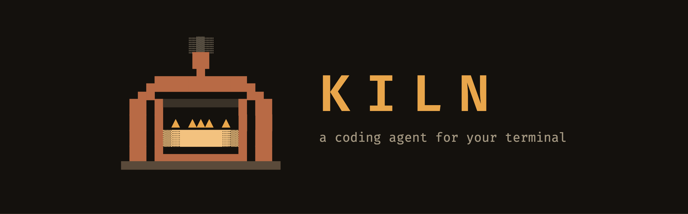

<p align="center">
  
</p>

# kiln

A coding agent with Claude Code's interface that runs on self-hosted models.

## Why

Claude Code's resident context floor is too large for a local model. Measured on
this machine, against a 32,768-token window:

| | tokens | % of window |
|---|---|---|
| Full MCP tool schemas (165 tools, 9 servers) | 31,897 | **97%** |
| Grafana alone (81 tools) | 19,992 | 61% |

The catalog fills the window before a system prompt, a file read, or a single
user turn. Tuning cannot fix that; the architecture has to change.

kiln keeps the same interface and slash commands but spends context
deliberately: tools are indexed rather than resident, skills load their bodies
only on invocation, and memory is budgeted against the model's actual window.

Measured on the same catalog: **1,514 tokens, 5% of the window**, a 26x
reduction that leaves the window for the conversation.

## What it is built on

kiln is a single Go binary. The agent loop, session format, compaction and
provider catalog are ports of [`@earendil-works/pi`](https://github.com/earendil-works/pi)
(MIT): sessions are pi's JSONL v4 and open in either implementation, and the
43 providers over 14 API shapes are pi-ai's catalog, vendored under
`internal/provider/catalog`. The terminal UI is
[Bubble Tea v2](https://github.com/charmbracelet/bubbletea); finished output is
committed to the terminal's own scrollback, only the live region repaints.

The interface follows the kiln "Ruled" design language (`docs/kiln-design.md`):
a labelled hairline rule above every transcript block, a warm-dark truecolor
palette, ruled diffs and permission prompts, and a block-letter banner.

kiln is model-agnostic: it works with local Ollama, an API key, or a Claude Pro/Max,
ChatGPT Plus/Pro, GitHub Copilot, Kimi or xAI subscription. No code path branches
on provider; only the budget tier differs.

## Install

```bash
curl -fsSL https://raw.githubusercontent.com/6cclab/kiln/main/scripts/install.sh | sh
```

`scripts/install.sh` installs the latest release's binary for macOS or Linux
(amd64 or arm64), or Windows (amd64, from Git Bash), to `~/.local/bin`, verifying
its checksum first. On Windows, run the command in Git Bash; the installed
file is `kiln.exe`. The installer prints a PATH hint if your shell cannot find it.

Options:

- `--ref <vX.Y.Z>` installs a different release.
- `--ref <branch|commit>`, `--from-source` or `--source <checkout>` builds from
  source instead. `--source` builds a local checkout in place of cloning.
- `--dir <path>` sets the install directory.

Building from source needs Go (the version go.mod names, or newer), and git
unless `--source` is given. Running the script again updates kiln in place. On
Unix, a running kiln keeps its old binary until restart; on Windows, close kiln
before updating so the executable can be replaced.

From a checkout:

```bash
sh scripts/install.sh --source .  # install this checkout, including kiln.exe on Windows
make build                      # macOS/Linux: bin/kiln, installed to Go's bin dir
```

## First run

Choose a model before starting a session. A fresh install includes none; the
built-in default (`ollama/qwen3.8:latest`) only works on machines that already
serve that exact model. To use a local Ollama model, install and start Ollama,
pull a model suited to your machine, then use the exact ID kiln lists:

```bash
model_id=your-chosen-model-id # replace with a model ID suitable for your machine
ollama pull "$model_id"
kiln models ollama
kiln --model "ollama/$model_id"
```

`kiln models` shows each available model's context and usable budget. With an
API key or subscription instead, check `kiln providers`, run
`kiln login <provider>`, then `kiln models <provider>` and
`kiln --model <provider>/<model-id-from-list>`. To make that model the default
for future sessions, set `HARNESS_MODEL` to the same `provider/model` value.
`kiln doctor --model <provider/model>` lists an unavailable model under
problems; it is a diagnostic report and still exits with status 0.

## Update and remove

To update, run the install command again, with the same `--dir` if you chose
one. To remove kiln, delete `~/.local/bin/kiln` (macOS/Linux) or
`~/.local/bin/kiln.exe` (Windows Git Bash); for a custom `--dir`, delete the file
there. If you used `make build`, remove the binary from Go's bin directory
(`go env GOBIN`, or `go env GOPATH` + `/bin` when GOBIN is empty). Run
`command -v kiln` if multiple copies exist.

Removing the binary leaves sessions and credentials in `~/.harness` and kiln
settings and memory in `~/.kiln`; delete those separately only if you no longer
want the data. Claude Code's `.claude` files and `~/.claude.json` are shared, so
do not remove them when uninstalling kiln.

## Use

```bash
kiln                      # interactive session
kiln -c                   # continue the most recent session here
kiln --resume <id>        # resume a specific session
kiln -p "fix the bug"     # one prompt, then exit (see --output-format)
kiln providers            # who you can talk to, and auth status
kiln models [provider]    # models, their tiers, and usable budget
kiln login anthropic      # log in with a Claude Pro/Max plan
kiln doctor               # model, tier, tools, MCP, hooks, agents, logs, problems
kiln mcp                  # MCP servers and their state
kiln --debug              # debug-level run log, path announced at startup
kiln --inline             # native scrollback instead of the default full-screen TUI
```

MCP servers connect in the background after the prompt appears. The footer shows
progress, and a one-line notice counts any servers that failed (`1 MCP server
unavailable · run /mcp`). `/mcp` names each failed server with a reason you can
act on; in print mode the same name and reason go to stderr. The model can use a
server's tools as soon as that server connects.

Every run writes a log to `~/.harness/logs` (the last 30 are kept). It records
startup phases with elapsed time, each server's connect outcome and duration, and
every turn, tool call, retry and compaction. `kiln doctor` prints the directory
and the latest file; attach that file to a bug report.

Inside a session: `/` for commands, `@` to reference a file, `!` to run a shell
command directly. `Ctrl+O` toggles the detailed transcript
(tool output and reasoning expanded), `Shift+Tab` cycles permission mode, `Esc`
interrupts, `Ctrl+C` twice exits.

`Ctrl+F` toggles full-screen mode (`--fullscreen` is accepted for compatibility).
In full-screen mode the transcript scrolls inside the terminal with `PgUp`/`PgDn`,
`Shift+Up`/`Shift+Down` or the mouse wheel, new output follows only while you are
at the bottom, and history re-wraps on resize. Full-screen is the default;
`--inline` uses the terminal's native scrollback. Toggling either way redraws the
transcript from the session log, so shell (`!`) output and hook notices that are
not part of the log do not survive the switch. The screen-reader flag always
uses inline.

`@path` inlines the file so the model has it without spending a turn on a read,
capped at the tier's per-result budget. `@screenshot.png` attaches the image
instead.

`/doctor` is the first thing to run when something looks wrong. It reports the
model, tier, tool strategy, MCP status, hooks and agents on one screen, with
problems last.

Credentials live in `~/.harness/credentials.json`, sessions in
`~/.harness/sessions`, prompt history in `~/.harness/history`. A stored
credential wins over an environment variable for the same provider.

## How context is kept small

- **Tiers.** The model's context window is the single place model choice becomes
  behavior. Everything downstream reads a tier and never asks which provider it
  is on, so the same code relaxes on a 200k model without branching.
- **Tool gating.** MCP tools are registered but inactive. The model sees a
  one-line index and calls `tool_search` to load the schemas it needs.
  Registration is free; activation is what costs tokens.
- **Postures.** A `coding` posture does not index UniFi or Grafana at all. This
  saves more than dynamic gating: indexing everything still costs 18% of a
  32k window, while a posture index costs 5%.
- **Skills.** Only `name` + `description` stay resident, in one place: the
  system prompt's skills index. The `skill` tool itself names no skill, so the
  catalog is never paid for twice. The index is budgeted at 1% of the context
  window (`internal/budget`'s `SkillsListingTokens`). Over budget, descriptions
  shrink before any skill is dropped from the listing, and project/user skills
  outlast plugin ones. A skill that still doesn't fit stays invocable by
  exact name; it is unlisted, with a pointer line saying so. Bodies load only on
  invocation.

  Measured against a real config (24 skills, mostly from enabled plugins) with a
  local capture server standing in for Ollama: a 49,152-token window's first
  request fell from ~13.3k to ~8.7k tokens (chars/4 estimate of the system
  prompt + tool schemas), and a 32,768-token window's from ~12.6k to ~7.8k. The
  `skill` tool's own schema, which used to re-embed every skill's name and
  description, fell from ~1,500 tokens to a fixed ~216 regardless of catalog
  size.
- **Subagents.** A `task` runs in its own session and window; the parent pays
  only for one paragraph.
- **Roles.** `settings.json`'s `modelRoles` (fast/structured/heavy →
  provider/model) is the one place model names appear; a `task` call picks a
  role instead of naming a provider and model itself. Concurrent `task` calls
  from one turn run in parallel, each in its own session. A subagent can
  dispatch subagents of its own, up to two levels deep; a role that crosses
  onto a different paid provider asks once per session per role, not once per
  dispatch.

## `.claude/` compatibility

kiln reads your existing Claude Code configuration exactly as Claude Code
does. It never writes its own settings to `~/.claude` or `<repo>/.claude`.
They go under `.kiln` instead (`~/.kiln` for user-scope state, `<repo>/.kiln`
for project/local state), which joins the Claude Code hierarchy at the same
scope and wins for a single value (model). MCP is the one deliberate
exception: `kiln mcp add`/`add-json`/`remove` write the *same* files
`claude mcp add` does (`~/.claude.json`, `.mcp.json`). kiln has no MCP file
of its own, so a server either tool adds is available to both.

| kiln writes | From | Mirrors |
|---|---|---|
| `<repo>/.kiln/settings.local.json` | `/permissions`, "don't ask again" | `.claude/settings.local.json` |
| `~/.kiln/settings.json` | `/model`'s default | `~/.claude/settings.json` |

A git-tracked or symlinked `<repo>/.kiln/settings.local.json` is held until
the folder is trusted; until then only its deny/ask rules apply. kiln stores
its own scoped project observations in `~/.kiln/memory.db`; see
[configuration](docs/configuration.md) for recall, correction, export and deletion.
An optional run observer can retain reviewable, source-checked records of
successful local Go test commands. It respects the user's learning and memory
opt-outs and does not treat test success as proof of task correctness.
Claude auto-memory remains read-only; the `/memory` slash command still opens
Claude Code's `CLAUDE.md` files in your editor.

| Asset read (never written) | Behavior |
|---|---|
| `~/.claude/skills`, `.claude/skills` | loaded, user-invocable ones become slash commands |
| `.claude/commands/*.md` | slash commands; nested dirs become `namespace:command` |
| `CLAUDE.md`, `@imports`, `.claude/rules/**/*.md` | system prompt, budgeted against the tier |
| `.claude/settings.json` | permissions, merged `user` → `project` → `local` |
| `~/.claude/projects/<project>/memory/MEMORY.md` | Claude Code's auto memory, read-only |
| `.claude/agents/*.md` | subagents, dispatched with the `task` tool |
| `.claude/settings.json` `modelRoles` | model roles for `task` dispatch (fast/structured/heavy → provider/model) |
| `~/.claude/keybindings.json` | editor key overrides; conflicts reported at startup |
| `.claude/settings.json` `hooks` | `PreToolUse`, `PostToolUse`, `UserPromptSubmit`, `SessionStart`, `SessionEnd`, `Stop`, `SubagentStop`, `Notification`, `PreCompact` |

| kiln and Claude Code share (written by either) | Behavior |
|---|---|
| `~/.claude.json`, `.mcp.json` | MCP servers; `kiln mcp add -s local\|user` writes `~/.claude.json`, `-s project` writes `.mcp.json` |

A `PreToolUse` hook may rewrite a command before it runs. Hooks run
**before** the permission gate, so the gate judges what will execute, not what
the model proposed. A blocking `Stop` hook keeps the turn going
and sends its reason to the model as a user message.

## Safety

Tool calls pass through a permission gate before running. Beyond the rules in
`settings.json`, any path **outside the workspace** requires confirmation even
when a rule allows the tool. `allow: [Read]` means "reading is fine here",
not "read anything on this machine". Widen the workspace with `/add-dir`. In
print mode there is nobody to ask, so `ask` is a refusal.

## Documentation

`docs/README.md` is the index. The short version:

- `docs/usage.md`: running a session, keys, slash commands, permissions, MCP, subagents.
- `docs/configuration.md`: flags, environment variables, `settings.json`, `.claude` assets, MCP config.
- `docs/troubleshooting.md`: `kiln doctor`, the run log, and the fix for each known symptom.
- `docs/architecture.md`: package map, lifecycle of a turn, sessions, budget, providers, tools.
- `docs/contributing.md`: building, testing, conventions, and how to add a tool, command or provider.

## Evaluation

`kiln eval` runs the built binary against a directory of scenarios
(`eval/scenarios/`, one prompt/fixture/check set per subdirectory). It grades
each run mechanically (`checks:` — file contents, tool calls, permission
blocks, usage, compaction, subagent dispatch, ...) and, where a scenario
declares a `judge:` rubric, with an LLM judge. Each run is written as one JSON
record to a timestamped file under `eval/results/`.

```bash
make eval                    # every scenario against the faux provider, then a report
bin/kiln eval run --only fix-bug -j 4
bin/kiln eval report --results eval/results --format md
```

`eval/results/baseline.jsonl` is the committed reference: `kiln eval report`
diffs the newest run against it and exits non-zero if any (scenario, model)
pair's score regresses past `--fail-on-regression`. Everything else under
`eval/results/` (timestamped run files, and `runs/` when `--keep` is passed)
is machine-local and gitignored.

Live runs (real providers, real network) are opt-in: `kiln eval run` refuses
any non-faux model unless `KILN_EVAL_LIVE=1` is set, so `make eval` never
leaves the faux provider. `make eval-live MODELS=ollama/qwen3.8` runs the
suite against real models instead.

The [GPT-6-Sol Kiln/Codex comparison](docs/gpt6-sol-comparison-report.md)
records a parallel same-model task, adversarial checks, and three blinded code
reviews. Both patches need fixes; Codex was faster and cheaper on this pair.

## Development

```bash
make check        # vet, staticcheck, gofmt, go test ./...
make e2e          # the real binary through a PTY and a scripted model (faux)
make e2e-live     # the same against a real model; HARNESS_E2E_LIVE=1, HARNESS_LIVE_MODEL=...
make eval         # eval/scenarios against faux, reported against eval/results/baseline.jsonl
```

Every screen assertion runs against an emulated terminal, never against the
bytes written, because every rendering bug in this project has shown up on
screen, not in the bytes. `docs/testing.md` explains the driver, the faux model server and
`kiln-drive`, which turns a bug report into a replayable script.

Two upstream libraries are vendored under `third_party/`, each with patches
described in its `HARNESS-PATCH.md`: ultraviolet (inline-renderer shrink
handling) and bubbletea (ordered `Println` commits, a full repaint of the live
region, restoring the caret after a committed line, and guarding autowrap on a
full-width committed line).

`docs/claude-code-parity.md` is the interface checklist. Items are marked
`[obs]` (directly observed) or `[chk]` (from familiarity, verify before
trusting).
